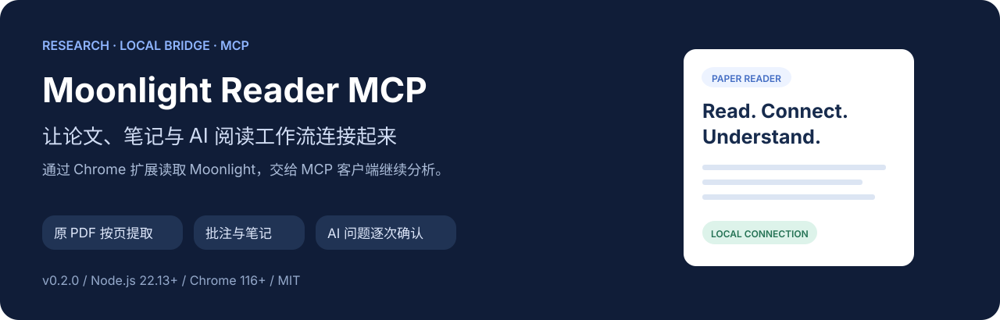
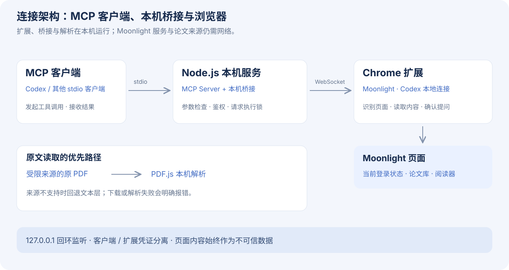
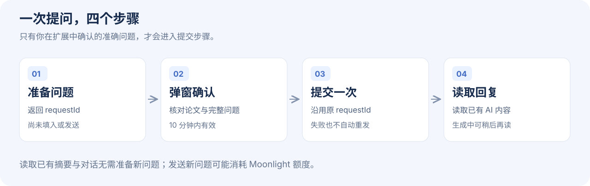
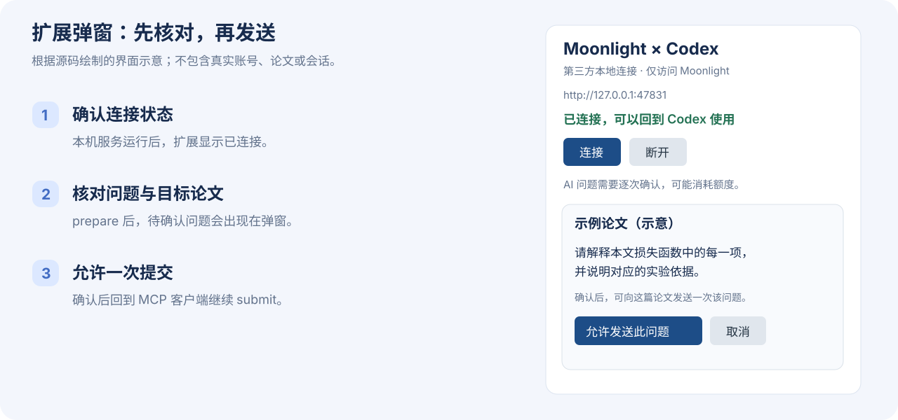

<div align="center">



# Moonlight Reader MCP

**把 Moonlight 里的论文、笔记与讨论，接入你的 AI 阅读工作流。**

Unofficial local MCP server for reading Moonlight papers, annotations and existing AI discussions through a Chrome extension. New AI questions require explicit approval in the extension popup.

[](package.json)
[](package.json)
[](extension/manifest.json)
[](LICENSE)

[快速开始](#快速开始) · [使用示例](#使用示例) · [工具参考](#工具参考) · [常见问题](#常见问题) · [参与贡献](#参与贡献)

</div>

> 第三方开源项目，面向 [themoonlight.io](https://www.themoonlight.io/) 论文阅读器，与 Moonlight 官方无隶属关系。无需 OpenAI API Key；使用 Chrome 中已有的 Moonlight 登录状态。客户端本身的模型配置及费用由所选 MCP 客户端决定。

## 它适合做什么

阅读论文时，原文、个人笔记、批注和 AI 讨论往往散落在不同面板中。本项目让 MCP 客户端通过工具获取这些内容，再继续整理、比较或解释。

例如，你可以让 Codex：

- 找出当前论文库列表中标题包含某个关键词的论文。
- 按页读取原文，解释公式、方法或实验设计，并保留页码引用。
- 结合你的高亮和笔记，整理阅读提纲或待解决的问题。
- 读取 Moonlight 已经生成的摘要与讨论，和论文原文交叉核对。
- 准备一个新问题，等你在扩展弹窗确认后，向 Moonlight 提交一次。

项目提供的是**内容读取与受控提交能力**。最终的分析和写作由 MCP 客户端完成；结果质量仍取决于来源完整性、问题和模型。

### 功能一览

| 能力 | 当前支持 | 使用时注意 |
| --- | --- | --- |
| 连接检查 | 本机服务、扩展连接、版本与进行中请求 | 首次使用先检查状态 |
| 标签页发现 | 仅列出 Moonlight 标签页 | 用返回的 `tabId` 指定操作目标 |
| 论文库读取 | 标题筛选、有限翻页 | 筛选已访问页面中实际渲染的条目 |
| 打开论文 | 按 Moonlight `paperId` 打开或复用页面 | 返回后仍可能需要等待页面加载 |
| 原文读取 | 原 PDF 优先，每次 1–10 页 | 不支持 OCR；公式、图片和双栏需对照 PDF |
| 阅读记录 | 笔记、高亮、评论、已有解释 | 受当前页面和侧栏可见内容限制 |
| 已有 AI 内容 | 摘要、解释、当前讨论 | 明确标为 AI 生成，不能当作原文 |
| 新 AI 提问 | 准备 → 弹窗确认 → 提交一次 | 可能消耗 Moonlight 额度 |
| 原生选区解释、布局翻译、译文导出 | 尚未实现 | 可通过问答请求文本解释或翻译 |

## 工作原理



三个部分协同工作：

1. **MCP 服务**向 Codex 等客户端提供工具，校验参数并返回结果。
2. **本机桥接**监听 `127.0.0.1:47831`，验证客户端和浏览器扩展的身份，避免页面操作重叠。
3. **Chrome 扩展**识别 Moonlight 标签页和阅读器，通过页面 DOM 与正常界面控件读取内容。

读取论文时，服务先获取页面提供的 PDF 来源；来源满足白名单和论文 ID 限制时，在本机使用 PDF.js 按页提取。来源不支持时，才回退到浏览器文本层。受支持来源的下载或解析失败会明确报错，不会把不完整文本包装成完整原文。

“本机运行”指桥接、扩展和解析组件的位置。访问 Moonlight 与 PDF 来源仍需网络；工具返回的内容也可能由你使用的 MCP 客户端传给其模型服务，请按客户端的数据政策使用。

## 快速开始

### 1. 检查环境

| 项目 | 要求 |
| --- | --- |
| Node.js | 22.13.0 或更新版本 |
| npm | 用于安装锁定的项目依赖 |
| Chrome | 116 或更新版本，允许加载已解压扩展 |
| Moonlight | 已登录账号，能正常打开论文库或论文阅读器 |
| MCP 客户端 | 支持 stdio；下文以 Codex 为例 |

已有真实环境验证基于 macOS + Chrome + Codex。自动化测试使用模拟网页与本机连接；其他桌面环境请核对本机路径和浏览器行为。

```sh
node --version
npm --version
```

### 2. 下载并初始化

```sh
git clone https://github.com/Maverick574038/themoonlight-mcp.git
cd themoonlight-mcp
npm ci
npm run setup
```

初始化会生成：

| 路径 | 用途 | 是否可公开 |
| --- | --- | --- |
| `.local/bridge.json` | 本机端口及两份独立连接凭证 | 否 |
| `.local/codex-config.toml` | 带本机绝对路径的客户端配置示例 | 否 |
| `extension-install/` | 可加载的扩展和本机连接配置 | 否 |

这些路径已加入 `.gitignore`。重新运行 `setup` 会复用有效配置中的凭证；现有配置损坏时会报错，不会悄悄更换凭证。

### 3. 加载 Chrome 扩展

1. 在 Chrome 地址栏输入 `chrome://extensions`。
2. 开启右上角的**开发者模式**。
3. 点击**加载已解压的扩展程序**。
4. 选择本项目生成的 **`extension-install` 文件夹**。
5. 在浏览器扩展菜单中找到 **Moonlight · Codex 本地连接**，可将其固定到工具栏。

请选 `extension-install/`，而不是 `extension/`。前者包含初始化时生成的本机连接配置，后者是供开发和版本管理使用的源文件。

### 4. 注册到 Codex

在项目根目录中执行以下命令，适用于 macOS/Linux shell：

```sh
codex mcp add themoonlight -- "$(command -v node)" "$PWD/src/server.mjs"
```

已注册时无需重复添加。重新加载 Codex 的 MCP 或开启新聊天，让客户端发现工具。

也可以手动配置：

```toml
[mcp_servers.themoonlight]
command = "/absolute/path/to/node"
args = ["/absolute/path/to/themoonlight-mcp/src/server.mjs"]
startup_timeout_sec = 20
tool_timeout_sec = 75
```

将路径替换为本机真实值。`npm run setup` 生成的 `.local/codex-config.toml` 已包含本机路径，可作为填写依据。Windows 使用实际的 `node.exe` 和项目绝对路径；上面的 shell 注册命令不能直接原样套用。

其他支持 stdio 的 MCP 客户端也可以连接同一服务，但各客户端的配置格式、模型与权限设置可能不同。

### 5. 连接并检查

1. 打开 Moonlight，确认已登录，并保留一个论文库或论文阅读器标签页。
2. 点击 Chrome 扩展图标，打开 **Moonlight × Codex** 弹窗。
3. 点击**连接**。本机服务正常后，弹窗会显示已连接状态。
4. 在项目目录执行：

```sh
npm run doctor
```

正常输出示意如下，具体版本和标签页数量以实际结果为准：

```text
本机 MCP：正常（127.0.0.1:47831）
本机服务版本：0.1.2；项目版本：0.1.2
Chrome 扩展：已完成鉴权连接
可用 Moonlight 标签页：1
```

`doctor` 会检查并尝试启动本机桥接；扩展连接后还会尝试列出标签页。它不会替你登录 Moonlight，也不会发送 AI 问题。

## 使用示例

### 第一次连接

可以把下面这段话交给 Codex：

```text
先检查 Moonlight MCP 的连接状态，再列出可用的 Moonlight 标签页。
告诉我每个标签页的标题、tabId 和地址，暂时不要发送新问题。
```

推荐顺序是 `moonlight_status` → `moonlight_tabs` → 选择目标 `tabId` → 读取对应内容。不要猜测标签页 ID。

### 检索论文库

```text
在当前 Moonlight 论文库中查找标题包含 uncertainty 的论文，最多访问 3 页。
列出标题和论文链接，并说明搜索覆盖范围以及是否还有后续页面。
```

这里的查询是对已访问列表页中的条目按标题筛选，不是 Moonlight 全站搜索，也不能保证覆盖未展开文件夹或虚拟列表中未呈现的内容。

### 按页精读

```text
读取当前论文第 1–3 页，按“研究问题、核心方法、证据、局限”整理。
每个关键判断附上对应页码；遇到图片、复杂公式或读取缺失时明确指出。
```

长文按 1–10、11–20 等区间分批读取，每次最多 10 页。先查看论文元信息，确认总页数。

### 结合笔记与高亮

```text
读取这篇论文的笔记和高亮，保留能够识别的原文位置。
结合第 2–4 页正文，整理我已经理解的内容和仍需澄清的问题。
区分论文原文、我的记录与 AI 推断。
```

### 读取已有讨论

```text
读取 Moonlight 已有的摘要和当前讨论，再与论文第 1 页对照。
指出哪些说法能直接由原文支持，哪些需要进一步核对。
```

读取已有内容使用 `moonlight_read_ai`；不需要为了查看回复而准备一个新问题。

## 向 Moonlight 提交新问题



新提问分成两个工具，避免“准备问题”与“实际发送”混在一起：

1. 调用 `moonlight_prepare_question`，传入目标 `tabId` 和完整问题。返回 `requestId`；此时未填入输入框，也未发送。
2. 打开 Chrome 扩展弹窗，核对目标论文和问题内容，点击**允许发送此问题**。请求从准备时起有效期为 10 分钟。
3. 回到 MCP 客户端，使用相同的 `tabId` 和 `requestId` 调用 `moonlight_submit_question`。
4. 使用 `moonlight_read_ai` 读取回复。仍在生成时，稍后再次读取。



*上图为界面示意，不是真实账号截图。实际标题、问题和连接状态以你的弹窗为准。*

例如：

```text
准备向当前论文提问：
“请用中文解释本文损失函数中的每一项，并说明对应的实验依据。”
先返回待确认请求，等我在扩展弹窗确认后再提交。
```

提交遵循以下规则：

- 每个 `requestId` 最多尝试发送一次；网络中断或超时不会自动重发。
- 已有草稿、问题内容变化、论文切换或检测到正在生成时，会阻止继续发送。
- 在提交进入尝试状态前可取消待确认请求；已尝试的请求不能通过取消来撤回。
- 页面操作超时后会保留执行锁，直到扩展返回结果或连接断开，防止旧操作还在进行时插入新操作。
- 取消 MCP 调用能停止本机等待和 PDF 解析，不能撤回已经注入页面或已经点击发送的操作。

提交状态不确定时，先核查页面和现有对话。不要为了重试而立即创建一个相同的新问题。

## 工具参考

当前提供 **10 个工具**。下表为参数摘要，完整校验见 [src/server.mjs](src/server.mjs) 和 [src/config.mjs](src/config.mjs)。

| 工具 | 参数 | 返回内容 / 作用 |
| --- | --- | --- |
| `moonlight_status` | 无 | 桥接与扩展状态、版本、进行中请求和诊断 |
| `moonlight_tabs` | 无 | Moonlight 标签页的 `tabId`、标题、地址与激活状态 |
| `moonlight_library` | `tabId`；可选 `query`、`maxPages` | 标题筛选结果、访问页数、`hasMore`、覆盖范围 |
| `moonlight_open_paper` | `paperId` | 复用已有页面或新建后台标签页，返回 `tabId` |
| `moonlight_paper` | `tabId` | 论文标识、总页数、已渲染页码、原 PDF 来源等 |
| `moonlight_pages` | `tabId`、`startPage`、`endPage` | 按页文字、提取方式、页码引用和完整性状态 |
| `moonlight_annotations` | `tabId`、`kind` | 对应侧栏中的笔记、高亮、评论或已有解释 |
| `moonlight_read_ai` | `tabId` | 当前可读取的 Moonlight AI 摘要、解释与讨论 |
| `moonlight_prepare_question` | `tabId`、`question` | 创建待确认请求，返回 `requestId` |
| `moonlight_submit_question` | `tabId`、`requestId` | 尝试提交已确认的准确问题，返回提交状态 |

参数限制：

| 参数 | 规则 |
| --- | --- |
| `tabId` | `moonlight_tabs` 返回的非负整数 |
| `paperId` | Moonlight 论文 UUID，可从论文链接或元信息获取 |
| `query` | 可选，默认空字符串，最多 500 个字符；按标题筛选 |
| `maxPages` | 可选，默认 1，范围 1–20 |
| `startPage` / `endPage` | 从 1 开始，包含首尾页，每次 1–10 页 |
| `kind` | `notes`、`highlights`、`comments`、`explanations` 之一 |
| `question` | 去除首尾空白后不能为空，最多 12,000 个字符 |
| `requestId` | prepare 返回的 32 位小写十六进制标识；不要自行构造 |

### 调用参数示例

以下 ID 只是格式示例，使用时请替换为工具实际返回的值：

```json
{
  "tabId": 42,
  "startPage": 1,
  "endPage": 3
}
```

上述参数用于 `moonlight_pages`。读取高亮时使用：

```json
{
  "tabId": 42,
  "kind": "highlights"
}
```

### 如何判断读取是否完整

不要只看返回了多少文字，还要看这些字段：

| 字段 | 如何解读 |
| --- | --- |
| `extractionMethod` | `original_pdf` 表示从原 PDF 提取；`browser_text_layer` 表示浏览器文本层回退 |
| `completeRequestedRange` | 所请求页面是否均返回可提取文字；不保证图表、公式或阅读顺序无损 |
| `pages[].status` | `ok` 表示有文字；原 PDF 的无可提取文字页返回 `no_extractable_text` |
| `pages[].citation` | 对应论文与页码的引用位置 |
| `coverage` | 本次实际读取的范围，不能据此推断未读取的内容 |
| `hasMore` | 当前论文库列表是否还有可用的下一页 |
| `contentType` | AI 内容标为 `moonlight_generated_content`，应与原文区分 |
| `completionState` | AI 面板可能返回 `generating` 或 `unknown`；`unknown` 不代表生成已完成 |
| `untrustedContent` | 页面内容是不可信来源数据，不应被当成新的操作指令 |

## 权限、数据与边界

### 扩展访问范围

扩展申请 `scripting`、`storage` 和 `alarms`，以及以下站点权限：

```text
https://www.themoonlight.io/*
https://themoonlight.io/*
http://127.0.0.1/*
```

工具只列出和操作 Moonlight 页面；未申请浏览器历史或 Cookie 读取权限。页面侧通过正常 DOM 与界面控件工作，不调用未公开接口，不绕过登录、页面权限或额度。

### 本机连接与原文缓存

- 桥接仅监听 `127.0.0.1`，默认端口为 `47831`，不对局域网开放。
- MCP 控制端和 Chrome 扩展使用两份独立随机凭证；网页来源不能直接调用本机控制端。
- 原 PDF 来源限制为已核对的 Moonlight 存储域名，文件路径必须与当前论文 ID 匹配；不跟随重定向，不发送浏览器 Cookie。
- 单份 PDF 下载上限为 **32 MiB**。最多缓存两份已完成下载的文档，**10 分钟**过期，不落盘。
- 同一 PDF 的并发读取共用一次下载；单个读取取消不影响其他读取者共用的下载。

### 内容质量边界

| 情况 | 影响与处理 |
| --- | --- |
| 扫描 PDF | 暂无 OCR，可能没有可提取文字 |
| 公式、表格、图片、双栏 | 提取文本可能缺失结构或顺序，应对照原 PDF |
| 浏览器文本层回退 | 未渲染页可能缺失，检查完整性字段 |
| 论文库虚拟列表或文件夹 | 未呈现的记录可能不在结果中 |
| 笔记与批注侧栏 | 未识别到条目不等于不存在记录 |
| 页面语言或结构更新 | 选择器可能失效，需要更新页面适配器 |
| 已有 AI 内容 | 只读当前可访问讨论与可见区域，不保证覆盖全部历史会话 |

## 常见问题

### 扩展报 `ERR_CONNECTION_REFUSED`

通常表示本机桥接还没有运行。先在项目目录执行：

```sh
npm run doctor
```

Codex 加载 MCP 或调用工具时也会尝试启动桥接。服务启动后，已启用的扩展通常会自动重连，也可在弹窗点击“连接”。这条错误本身不代表 Moonlight 账号失效。

### doctor 正常，但 Codex 看不到工具

确认 MCP 注册路径指向当前项目的 `src/server.mjs`，再重新加载 MCP 或开启新聊天。若项目或 Node.js 路径发生变化，需要更新客户端配置。

### 扩展加载后报缺少 `connection.js`

先执行 `npm run setup`，再加载生成的 `extension-install/`。直接加载 `extension/` 源目录没有本机连接配置。

### 服务版本和扩展版本不同

更新代码后重新执行 `npm ci` 和 `npm run setup`，再到 `chrome://extensions` 重新加载本扩展。已有 MCP 进程也需要重新加载；本机桥接若仍是旧版，应在没有进行中页面操作时停止旧进程，再由客户端或 `doctor` 启动。

### 提示“未找到对应页面”或“检测到多个阅读器”

重新调用 `moonlight_tabs`，确认目标标签页正确，等待 Moonlight 加载。论文库工具需要列表页，论文与批注工具需要阅读器。检测到多个阅读器时会在执行前停止，避免误读或重复发送。

### 原文读取失败或页码缺失

先查看论文总页数和错误信息，缩小读取范围。受支持 PDF 来源下载失败会直接报错；来源不支持时才回退浏览器文本层。扫描页需要其他 OCR 工具，不能用 AI 摘要冒充缺失原文。

### 提问后提示超时、未确认或状态不确定

- **未确认**：打开扩展弹窗，核对并允许当前请求。
- **已过期**：旧请求无法再确认；先核查是否发送，再决定是否准备新请求。
- **超时或状态不确定**：先等待当前操作结束并查看网页对话，不要立即重发。
- **长期占用执行锁**：在扩展弹窗断开并重新连接，再核查对话与连接状态。

### 端口被占用或连接配置无效

用 `npm run bridge` 在前台查看启动错误，并核对 `.local/bridge.json`。不要在公开 Issue 中粘贴完整配置或凭证。若修改配置中的端口，需要重新执行 `setup` 并重新加载扩展，使两端保持一致。

### 能否直接通过 npm 安装，或在商店安装扩展

当前安装方式是克隆仓库、安装依赖，再加载已解压扩展。项目的 `package.json` 设置了 `private: true`，用于避免误发到 npm；GitHub 公开与 MIT 授权不受此字段影响。

## 开发与验证

### 常用命令

| 命令 | 用途 |
| --- | --- |
| `npm ci` | 按锁文件安装依赖 |
| `npm run setup` | 生成本机凭证、扩展安装目录与配置示例 |
| `npm start` | 启动 stdio MCP 服务，通常由客户端管理 |
| `npm run bridge` | 前台运行本机桥接，便于查看错误 |
| `npm run doctor` | 检查服务、扩展、版本和可用标签页 |
| `npm run check` | 检查源模块与扩展脚本语法 |
| `npm test` | 运行自动化测试 |

自动化测试使用模拟页面、临时配置和本机随机端口，不需要真实 Moonlight 登录，也不会发送真实 AI 问题。

最近一次本机验证（2026-11-12）：**62 项测试通过，0 失败**。测试包含页面读取、草稿保护、弹窗确认、去重、断线恢复、中文传输、参数与配置检查、PDF 缓存和取消，以及官方客户端的真实 stdio 握手。完整范围与真实界面验证边界见 [VALIDATION.md](VALIDATION.md)。仓库附带 Node.js 22 / 24 / 26 的 CI 配置；本机测试结果不代表这些远程任务已经运行成功。

### 目录结构

```text
themoonlight-mcp/
├── src/
│   ├── server.mjs              # MCP 工具注册与错误返回
│   ├── bridge.mjs              # 回环 HTTP / WebSocket 桥接
│   ├── client.mjs              # 桥接启动、请求与取消
│   ├── config.mjs              # 配置和命令参数校验
│   ├── pdf.mjs                 # PDF 来源检查、缓存和按页提取
│   ├── setup.mjs               # 本机初始化
│   └── doctor.mjs              # 连接诊断
├── extension/                  # 可公开的 Chrome 扩展源代码
├── test/                       # 自动化回归测试
├── docs/images/                # README 原创 SVG 配图
├── .github/workflows/ci.yml     # 持续集成配置
├── codex-config.example.toml    # 无个人路径的配置模板
├── CONTRIBUTING.md
├── SECURITY.md
├── VALIDATION.md
└── LICENSE
```

`.local/`、`extension-install/` 和 `node_modules/` 为本机生成内容，不应提交。

### 版本说明

0.1.2 修复了异常消息导致桥接退出、中文分块传输损坏、超时后操作重叠、确认后内容变化仍可能发送、论文库翻页漏读，以及 PDF 重复下载与取消处理等问题。

后续改进方向包括：更多真实非空笔记与批注样例、页面变化适配、更多平台验证，以及对原生选区解释和布局翻译的单独适配。这些是待探索方向，不代表当前已经实现。

## 停用与移除

临时停用：在扩展弹窗点击**断开**。

完整移除：

1. 在 Chrome 扩展管理页移除本扩展。
2. 从 Codex 移除 MCP：

```sh
codex mcp remove themoonlight
```

扩展保持已鉴权连接时，桥接持续运行；扩展断开且无进行中请求时，桥接会在空闲 30 分钟后退出。本项目不会注册系统开机启动项。需要立即结束旧服务时，请先确认没有进行中的页面操作。

## 参与贡献

欢迎提交 Issue 和 Pull Request。请提供版本、复现步骤、预期结果及脱敏后的错误信息，并在修改行为时补充相应测试。

- [贡献指南](CONTRIBUTING.md)
- [安全说明](SECURITY.md)
- [验证记录](VALIDATION.md)
- [提交问题](https://github.com/Maverick574038/themoonlight-mcp/issues)

请勿上传连接凭证、Cookie、私人笔记、论文原文或未经授权的页面数据。

## 许可证

本项目采用 [MIT License](LICENSE)，允许按许可证条款使用、修改和分发。第三方依赖保留各自许可证；Moonlight 品牌、论文和网站内容不在本项目的授权范围内。
